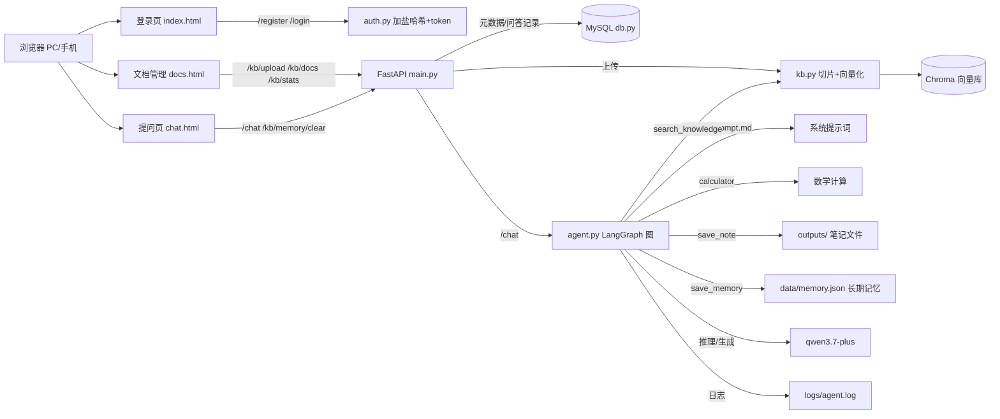

# kb_qa — 基于智能体的多用户知识库问答平台

基于 **LangChain + LangGraph + RAG** 的多用户知识库问答系统：用户注册登录后上传文档（PDF / TXT / Markdown / DOCX / PPTX），系统切片向量化存入 Chroma；ReAct Agent 自主规划检索、按需调用 4 个 Python 工具（检索 / 计算 / 笔记导出 / 长期记忆），**只依据文档内容回答，不编造**，回答标注来源文件名与页码，并可把回答整理成 Markdown 学习笔记落盘。

> 在线演示：`http://<服务器IP>:8000/`（部署于阿里云轻量应用服务器，Docker 容器化运行）

## 功能特性

- **用户系统**：注册 / 登录，密码加盐哈希存储（库中无明文），token 鉴权
- **文档上传入库**：自动切片 → 向量化 → 存入 Chroma；文件哈希去重；MySQL 记录元数据
- **智能问答（ReAct 双层循环）**：外层连续对话，内层"思考→行动→观察"迭代（最多 5 轮），Agent 自主决定"检索还是直接回答"
- **RAG 引用溯源**：混合检索（向量 + BM25 + RRF 融合重排），回答强制标注来源文件名与页码；资料未覆盖时明确声明并标注"通用知识补充"
- **两种记忆**：
  - 短期：多轮对话上下文（LangGraph checkpointer，支持追问，如"那要带什么材料"）
  - 长期：用户偏好 / 学习进度存 JSON（`data/memory.json`），**重启后读取并注入提示词实际使用**，提供页面一键清除
- **四个 Python 工具**（名称 / 用途 / 参数说明见 [system_prompt.md](system_prompt.md) 与 `app/tools.py`）：
  1. `search_knowledge` — 知识库混合检索
  2. `calculator` — 数学计算（ast 白名单解析，防 eval 注入）
  3. `save_note` — 把回答整理成 Markdown 笔记落盘 `outputs/`（可直接打开查看的成果文件）
  4. `save_memory` — 把用户偏好 / 进度写入长期记忆 JSON
- **结构化日志**：`logs/agent.log` 记录模型名、每轮耗时、Token 用量、工具调用（名称 / 参数 / 结果摘要）、任务总耗时
- **多端互动**：提问端每次提问，管理端实时可见"文档被问次数 + 最近问题 + 实时动态弹窗"
- **权限与审核流**：上传文档需管理员审核（pending → approved / rejected），审核通过才入库可检索
- **容器化部署**：docker compose 一条命令拉起 应用 + MySQL 两个容器

## 技术栈

| 层 | 技术 |
|---|---|
| LLM | 通义千问 qwen3.7-plus（DashScope API） |
| Embedding | text-embedding-v3 |
| 向量库 | Chroma（本地持久化，存文档切片与语义检索） |
| 业务数据库 | MySQL 8（用户 / 文档 / 问答记录） |
| Agent | LangGraph（StateGraph + MemorySaver 多轮记忆） |
| 后端 | FastAPI + uvicorn |
| 前端 | 原生 HTML + JavaScript（三个页面，fetch 调接口，前后端分离） |
| 部署 | Docker + docker compose（应用容器 + MySQL 容器） |

## 架构



**两个库的分工**：MySQL 管"业务数据"（谁传了什么、谁问了什么、命中哪个文档），Chroma 管"文档切片"（负责语义检索）。

## 快速启动（3 分钟）

### 方式一：本地直接运行

```bash
# 1. 安装依赖（Python 3.10+）
pip install -r requirements.txt

# 2. 准备 MySQL：建库并创建专用用户（最小权限）
mysql -u root -p -e "CREATE USER IF NOT EXISTS 'kbqa'@'%' IDENTIFIED BY '你的密码'; CREATE DATABASE IF NOT EXISTS kb_qa CHARACTER SET utf8mb4; GRANT ALL PRIVILEGES ON kb_qa.* TO 'kbqa'@'%'; FLUSH PRIVILEGES;"

# 3. 在 kb_qa 目录创建 .env：
#    DASHSCOPE_API_KEY=sk-xxx
#    DASHSCOPE_BASE_URL=https://xxx/compatible-mode/v1
#    MYSQL_HOST=127.0.0.1
#    MYSQL_PORT=3306
#    MYSQL_USER=kbqa
#    MYSQL_PASSWORD=你的密码
#    MYSQL_DB=kb_qa

# 4. 启动（在 kb_qa 目录下）
python main.py
```

### 方式二：Docker 一键启动（含 MySQL 容器）

```bash
# .env 里保留 DASHSCOPE_* 与 MYSQL_*（密码自定），然后：
docker compose up -d --build
```

启动后（应用启动时自动建表）：
- 网页入口：<http://127.0.0.1:8000/> （注册 → 登录 → 上传文档 → 提问）
- 接口文档（Swagger）：<http://127.0.0.1:8000/docs>
- 旧版 Gradio 演示页：<http://127.0.0.1:8000/ui>

## 项目结构

```
kb_qa/
├── app/
│   ├── config.py    # 配置中心：路径、模型、切片、MySQL 参数（.env 锚定到项目根目录）
│   ├── db.py        # 业务数据库：MySQL 建表 + users/documents/qa_history 增删查
│   ├── auth.py      # 认证模块：加盐哈希、注册/登录、token 校验
│   ├── kb.py        # 资料整理/索引/检索：读文件、切片、入库、混合检索（记录命中来源）
│   ├── tools.py     # 工具函数：4 个智能体工具（检索/计算/笔记导出/长期记忆）
│   ├── memory.py    # 长期记忆：用户偏好/进度存 JSON，重启读取、可更新可清除
│   ├── logger.py    # 结构化日志：模型名/工具调用/耗时/Token 用量
│   └── agent.py     # LangGraph ReAct Agent：双层循环编排 + 多轮记忆
├── static/          # 网页前端（前后端分离，fetch 调接口）
│   ├── index.html   # 登录 / 注册页
│   ├── docs.html    # 文档管理页（列表 / 上传 / 审核状态 / 互动看板）
│   ├── admin.html   # 管理端（文档审核：通过入库 / 驳回）
│   └── chat.html    # 问答页（多轮对话 / 清除长期记忆）
├── system_prompt.md # 系统提示词：智能体职责、工具规则、输出要求（外置文件）
├── examples/        # 知识库资料（课程课件，README 末尾附来源）
├── main.py          # 入口：FastAPI 接口 + 静态页面挂载 + Gradio 演示页
├── data/            # 长期记忆 memory.json（运行时自动创建）
├── outputs/         # 成果文件：智能体生成的 Markdown 学习笔记
├── logs/            # 运行日志 agent.log（运行时自动创建）
├── docker-compose.yml  # 应用容器 + MySQL 容器编排
├── Dockerfile
├── requirements.txt
└── .env             # 密钥与数据库配置（不进仓库）
```

## API 说明

| 接口 | 方法 | 鉴权 | 说明 |
|---|---|---|---|
| `/register` | POST | - | 注册 `{"username","password"}` |
| `/login` | POST | - | 登录，返回 token 与 is_admin |
| `/chat` | POST | X-Token | 提问（长期记忆自动注入），问答记录写入 MySQL |
| `/chat/stream` | POST | X-Token | 流式问答（SSE，可实时看到推理过程） |
| `/kb/memory/clear` | POST | X-Token | 清除当前用户全部长期记忆 |
| `/kb/upload` | POST | X-Token | 上传文档（进入待审核，管理员通过后入库） |
| `/kb/docs` | GET | - | 文档列表（含审核状态） |
| `/kb/docs/{id}` | DELETE | X-Token | 删除文档（仅本人或管理员） |
| `/kb/stats` | GET | X-Token | 互动看板：每个文档被问次数 + 最近问题 |
| `/kb/activity` | GET | X-Token | 实时动态（多端互动的数据源，前端 3 秒轮询） |

登录后前端每个请求带 `X-Token` 请求头；`session_id` 对应 Agent 的 thread_id，相同 id 共享多轮记忆。

## 智能体工具一览

| 工具 | 用途 | 参数 | 运行时可观察 |
|---|---|---|---|
| `search_knowledge` | 知识库混合检索，返回带来源的片段 | 检索关键词或问句 | 日志记录参数与结果摘要；前端流式输出可见"行动/行动输入" |
| `calculator` | 数学计算（ast 白名单，防注入） | 算式字符串 | 日志记录算式与结果 |
| `save_note` | 生成 Markdown 学习笔记（成果文件） | `标题\|内容` | 日志记录保存路径；outputs/ 可直接打开 |
| `save_memory` | 记住用户偏好/进度（长期记忆） | `键\|值` | 日志记录；data/memory.json 可查看 |

## 多端互动演示（验收脚本）

1. **A 端（PC）**：注册登录 → 上传《校园卡使用说明.md》→ 文档管理页出现该文档（待审核）
2. **管理员**：admin.html 审核通过 → 文档"已入库"可检索
3. **B 端（手机浏览器）**：提问"校园卡丢了怎么补办" → 回答正确且带来源
4. **回到 A 端**：看板显示"被问 1 次 + 最近问题"，实时动态弹出"B 端提问了 xxx"——B 端的行为 3 秒内反映到 A 端

## 知识库资料来源

`examples/` 下的课件为本校《软件工程与 UML》《AI 大模型应用开发》等课程的课堂资料（教师分发），另有示例文档用于快速体验。部署时通过网页上传入库（`data/` 知识库目录按作业要求对应 `examples/`）。

## 验收标准对照（Python 应用开发大作业）

| 作业要求 | 实现位置 |
|---|---|
| 大模型调用与提示词设计 | app/agent.py（DashScope 真实调用）+ system_prompt.md（职责/工具规则/输出要求） |
| 至少三个 Python 工具 | app/tools.py：search_knowledge / calculator / save_note / save_memory |
| 内外双层循环 | 外层 Web 连续对话；内层 LangGraph agent→tool 迭代（MAX_STEPS=5） |
| RAG（来源明确+标注出处） | app/kb.py 混合检索 + 回答强制角标 + 片段带文件名页码 |
| 两种记忆 | 短期：LangGraph checkpointer 多轮历史；长期：app/memory.py JSON（重启读取、可更新可清除） |
| 记录日志 | app/logger.py → logs/agent.log（模型名/工具/耗时/Token 用量） |
| 结果输出 | save_note 工具 → outputs/*.md 成果文件 |
| 加分：语义检索+混合检索重排 | app/kb.py（向量 + BM25 + RRF 融合） |
| 加分：向量数据库 | Chroma + text-embedding-v3 句向量 |

## 已知局限与扩展方向

- **单一知识库**：所有文档共用一个 collection，可按用户/场景隔离多知识库
- **token 存内存**：重启后需重新登录，可换 Redis 或 JWT
- **长期记忆单文件**：data/memory.json 单文件 + 线程锁，生产应换数据库
- **上下文压缩**：多轮历史超长时仅截断 10 轮，可引入摘要压缩
