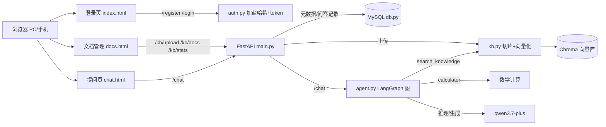

# kb_qa — 多用户知识库问答平台

基于 **LangChain + LangGraph + RAG** 的多用户知识库问答系统：用户注册登录后上传文档（PDF / TXT / Markdown），系统切片向量化存入 Chroma；ReAct Agent 自主检索资料、按需调用计算工具，**只依据文档内容回答，不编造**，并附带来源文件名。前端提供登录 / 文档管理 / 问答三个网页，支持 PC 与手机访问；文档管理与问答两端通过互动看板联动。

> 在线演示：`http://<服务器IP>:8000/`（部署于阿里云轻量应用服务器，Docker 容器化运行）

## 功能特性

- **用户系统**：注册 / 登录，密码加盐哈希存储（库中无明文），token 鉴权
- **权限控制**：未登录不能上传；文档归属上传者，只能删除自己上传的文档
- **文档上传入库**：自动切片 → 向量化 → 存入 Chroma；MySQL 记录文档元数据与 Chroma 切片 id
- **智能问答**：ReAct Agent 自主决定"检索还是直接回答"，支持多轮对话（上下文记忆）
- **引用溯源**：回答依据的片段带来源文件名，问答记录与命中文档关联入库
- **互动看板**：提问端每次提问，管理端实时可见"文档被问次数 + 最近问题"（多端联动）
- **计算工具**：数学表达式由 calculator 工具计算，不靠模型口算
- **拒答机制**：资料里没有的内容，明确回答"根据现有资料无法回答"
- **容器化部署**：docker compose 一条命令拉起 应用 + MySQL 两个容器

## 技术栈

| 层 | 技术 |
|---|---|
| LLM | 通义千问 qwen3.7-plus（DashScope API） |
| Embedding | text-embedding-v3 |
| 向量库 | Chroma（本地持久化，存文档切片与语义检索） |
| 业务数据库 | MySQL 8（用户 / 文档 / 问答记录） |
| Agent | LangGraph（StateGraph + MemorySaver 多轮记忆） |
| 后端 | FastAPI + uvicorn |
| 前端 | 原生 HTML + JavaScript（三个页面，fetch 调接口，前后端分离） |
| 部署 | Docker + docker compose（应用容器 + MySQL 容器） |

## 架构



**两个库的分工**：MySQL 管"业务数据"（谁传了什么、谁问了什么、命中哪个文档），Chroma 管"文档切片"（负责语义检索）。

## 快速启动（3 分钟）

### 方式一：本地直接运行

```bash
# 1. 安装依赖（Python 3.10+）
pip install -r requirements.txt

# 2. 准备 MySQL：建库并创建专用用户（最小权限）
mysql -u root -p -e "CREATE USER IF NOT EXISTS 'kbqa'@'%' IDENTIFIED BY '你的密码'; CREATE DATABASE IF NOT EXISTS kb_qa CHARACTER SET utf8mb4; GRANT ALL PRIVILEGES ON kb_qa.* TO 'kbqa'@'%'; FLUSH PRIVILEGES;"

# 3. 在 kb_qa 目录创建 .env：
#    DASHSCOPE_API_KEY=sk-xxx
#    DASHSCOPE_BASE_URL=https://xxx/compatible-mode/v1
#    MYSQL_HOST=127.0.0.1
#    MYSQL_PORT=3306
#    MYSQL_USER=kbqa
#    MYSQL_PASSWORD=你的密码
#    MYSQL_DB=kb_qa

# 4. 启动（在 kb_qa 目录下）
python main.py
```

### 方式二：Docker 一键启动（含 MySQL 容器）

```bash
# .env 里保留 DASHSCOPE_* 与 MYSQL_*（密码自定），然后：
docker compose up -d --build
```

启动后（应用启动时自动建表）：
- 网页入口：<http://127.0.0.1:8000/> （注册 → 登录 → 上传文档 → 提问）
- 接口文档（Swagger）：<http://127.0.0.1:8000/docs>
- 旧版 Gradio 演示页：<http://127.0.0.1:8000/ui>

## 项目结构

```
kb_qa/
├── app/
│   ├── config.py    # 配置中心：路径、模型、切片、MySQL 参数（.env 锚定到项目根目录）
│   ├── db.py        # 业务数据库：MySQL 建表 + users/documents/qa_history 增删查
│   ├── auth.py      # 认证模块：加盐哈希、注册/登录、token 校验
│   ├── kb.py        # 知识库模块：读文件、切片、入库、检索（记录命中来源）
│   └── agent.py     # LangGraph ReAct Agent：状态机 + 工具表 + 多轮记忆
├── static/          # 网页前端（前后端分离，fetch 调接口）
│   ├── index.html   # 登录 / 注册页
│   ├── docs.html    # 文档管理页（列表 / 上传 / 删除 / 互动看板）
│   └── chat.html    # 问答页（多轮对话，独立 session_id）
├── main.py          # 入口：FastAPI 接口 + 静态页面挂载 + Gradio 演示页
├── docker-compose.yml  # 应用容器 + MySQL 容器编排
├── Dockerfile
├── examples/        # 示例文档
├── uploads/         # 上传文件落地目录（运行时自动创建）
└── chroma_db/       # 向量库持久化目录（运行时自动创建）
```

## API 说明

| 接口 | 方法 | 鉴权 | 说明 |
|---|---|---|---|
| `/register` | POST | - | 注册 `{"username","password"}` |
| `/login` | POST | - | 登录，返回 token |
| `/chat` | POST | - | 提问，问答记录写入 MySQL |
| `/kb/upload` | POST | X-Token | 上传文档入库（MySQL + Chroma 双写） |
| `/kb/docs` | GET | - | 文档列表 |
| `/kb/docs/{id}` | DELETE | X-Token | 删除文档（仅本人）：MySQL + Chroma + 物理文件三处一起删 |
| `/kb/stats` | GET | - | 互动看板：每个文档被问次数 + 最近问题 |

登录后前端每个请求带 `X-Token` 请求头；`session_id` 对应 Agent 的 thread_id，相同 id 共享多轮记忆。

## 多端互动演示（验收脚本）

1. **A 端（PC）**：注册登录 → 上传《校园卡使用说明.md》→ 文档管理页出现该文档，看板显示"被问 0 次"
2. **B 端（手机浏览器或另一台电脑）**：打开同一网址 → 登录另一账号 → 提问"校园卡丢了怎么补办" → 回答正确且带来源
3. **回到 A 端刷新**：看板显示"被问 1 次 + 最近问题"——B 端的行为实时反映到 A 端（数据经 MySQL）
4. **A 端删除文档**：再提问同一问题 → 系统拒答（向量库同步删除，证明三处删除生效）

## 验收标准对照

| 要求 | 实现 |
|---|---|
| 前端增删数据 → 后端处理 → 数据库变化 | 上传/删除文档走网页 → FastAPI 业务处理 → MySQL documents 表增删 + Chroma 切片增删；提问写 qa_history |
| 多端系统互动 | 提问端（B 端/手机）提问 → 管理端（A 端）看板实时显示被问次数与最新问题 |
| 每个人有 GitHub 提交记录 | 本仓库 commit 历史 |
| 不同网络可访问 | 部署在云服务器，公网 IP 直接访问 |

## 已知局限与扩展方向

- **单一知识库**：所有文档共用一个 collection，可按用户/场景隔离多知识库
- **纯向量检索**：对精确关键词（如编号、专有名词）偏弱，可加 BM25 混合检索
- **重复入库**：同一文件重复上传会产生重复切片，可按文件哈希去重
- **token 存内存**：重启后需重新登录，可换 Redis 或 JWT
- **问答命中统计是模块级变量**：并发场景下来源可能串写，可改为 Agent 返回结构化来源
